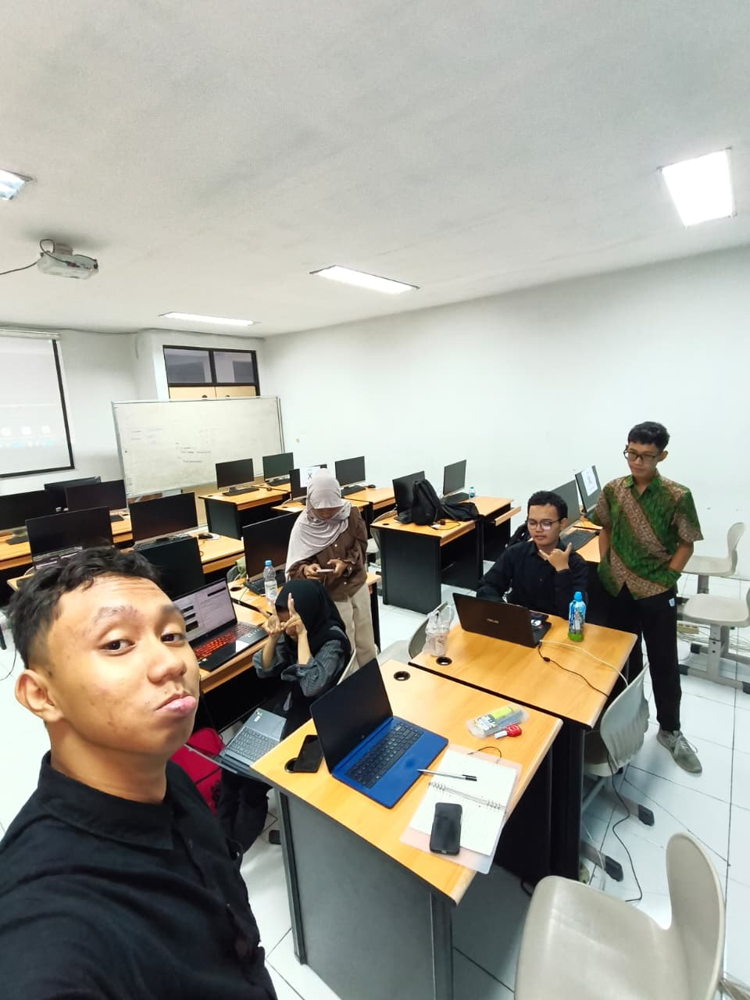

# Praktikum Modul 12: Pemrosesan Query dengan MongoDB

Praktikum Basis Data Modul 12 (konsep pemrosesan query) dengan **MongoDB** sebagai DBMS target.
Kelompok 1C TRPL, studi kasus **TepatSasar** (SDG 1 Tanpa Kemiskinan, pendataan warga prasejahtera di Madiun).


## Dokumentasi Kerja Kelompok (ada juga bersama kelompok lain)




## Ringkasan

Repositori ini berisi seluruh skrip dan diagram praktikum, yang mencakup:

- migrasi data latihan (kasus layanan transportasi) ke MongoDB,
- aljabar relasional, query tree, dan perbandingan dua urutan operasi,
- inspeksi *execution plan* sebelum dan sesudah index,
- pengujian kontrol akses DCL (RBAC),
- rancangan dan implementasi migrasi data TepatSasar dari MySQL ke MongoDB.

## Lingkungan

| Komponen | Versi / keterangan |
| --- | --- |
| DBMS target | MongoDB Community Server 9.0.8 |
| Klien | mongosh 2.14.2, MongoDB Compass |
| Sistem operasi | Windows |
| Editor | Visual Studio Code dengan terminal PowerShell |

## Struktur Folder

```
praktikum_modul12
├── scripts
│   ├── 01_migrasi_data_latihan.js
│   ├── 02_query_transportasi.js
│   ├── 03_pengujian_dcl.js
│   ├── 04_rancangan_migrasi_pjbl.js
│   ├── 05_migrasi_tepatsasar.js
│   ├── 06_query_tepatsasar.js
│   └── 06b_data_besar_tepatsasar.js
├── diagram
│   ├── query_tree.png
│   ├── query_tree_pushdown.png
│   └── query_tree_kf08.png
├── dokumentasi
└── README.md
```

## Daftar Skrip

| Skrip | Database | Fungsi |
| --- | --- | --- |
| `01_migrasi_data_latihan.js` | `transport_db` | Migrasi data ROUTES (3 dokumen) dan TRIPS (6 dokumen) ke MongoDB |
| `02_query_transportasi.js` | `transport_db` | Query utama dan `explain` sebelum serta sesudah index `idx_route_started` |
| `03_pengujian_dcl.js` | `transport_db` | Skrip RBAC yang menyesuaikan diri dengan akun yang login: uji tanpa login, membuat akun dan GRANT/REVOKE (`admin_ta`), serta uji `report_user` |
| `04_rancangan_migrasi_pjbl.js` | `tepatsasar` | Rancangan migrasi fitur KF-08 (skema, query, index, role), tidak wajib dijalankan |
| `05_migrasi_tepatsasar.js` | `tepatsasar` | Migrasi data `modul10.sql` (MySQL) ke MongoDB dengan dokumen tersemat |
| `06_query_tepatsasar.js` | `tepatsasar` | Query, CRUD, dan uji integritas data TepatSasar |
| `06b_data_besar_tepatsasar.js` | `tepatsasar` | Bonus: 50.000 dokumen untuk membandingkan `explain` sebelum dan sesudah index |

## Cara Menjalankan

Jalankan dari folder `praktikum_modul12` melalui terminal PowerShell. Autentikasi MongoDB aktif pada konfigurasi ini, sehingga koneksi memakai akun administrator dan meminta password saat dijalankan.

```powershell
# Kasus latihan (transport_db)
mongosh 'mongodb://127.0.0.1:27017/admin' -u admin_ta -p --authenticationDatabase admin --file scripts/01_migrasi_data_latihan.js
mongosh 'mongodb://127.0.0.1:27017/admin' -u admin_ta -p --authenticationDatabase admin --file scripts/02_query_transportasi.js

# Kasus TepatSasar (tepatsasar)
mongosh 'mongodb://127.0.0.1:27017/admin' -u admin_ta -p --authenticationDatabase admin --file scripts/05_migrasi_tepatsasar.js
mongosh 'mongodb://127.0.0.1:27017/admin' -u admin_ta -p --authenticationDatabase admin --file scripts/06_query_tepatsasar.js
```

Skrip `03_pengujian_dcl.js` dijalankan beberapa kali dengan akun berbeda. Nilai `TAHAP` di dalam skrip dipilih untuk sesi `admin_ta` (1 = buat akun dan GRANT, 2 = REVOKE, 3 = GRANT ulang):

```powershell
# tanpa login: harus ditolak
mongosh 'mongodb://127.0.0.1:27017/transport_db' --file scripts/03_pengujian_dcl.js

# admin_ta (TAHAP = 1, lalu TAHAP = 2 untuk REVOKE)
mongosh 'mongodb://127.0.0.1:27017/admin' -u admin_ta -p --authenticationDatabase admin --file scripts/03_pengujian_dcl.js

# uji akun report_user (sebelum dan sesudah REVOKE)
mongosh 'mongodb://127.0.0.1:27017/transport_db' -u report_user -p --authenticationDatabase transport_db --file scripts/03_pengujian_dcl.js
```

## Kasus Latihan: Layanan Transportasi

**Kebutuhan informasi:** menampilkan `trip_id`, `started_at`, dan `route_name` untuk perjalanan pada rute 12 sejak 1 November 2026.

**Ekspresi aljabar relasional:**

```
π trip_id, started_at, route_name ( σ route_id = 12 ∧ started_at ≥ '2026-11-01' ( TRIPS ⋈ TRIPS.route_id = ROUTES.route_id ROUTES ) )
```

**Pemetaan ke MongoDB:**

| Operator relasional | Stage pipeline |
| --- | --- |
| Seleksi (σ) | `$match` |
| Join (⋈) | `$lookup` dan `$unwind` |
| Proyeksi (π) | `$project` |

**Hasil:** tiga perjalanan, yaitu T001, T003, dan T005.

**Perbandingan urutan operasi:**

| Ukuran | Rencana 1 (join dahulu) | Rencana 2 (seleksi dahulu) |
| --- | --- | --- |
| Hasil antara terbesar | 6 baris | 3 baris |
| Total baris semua operator | 12 | 9 |

Pipeline pada `02_query_transportasi.js` menempatkan `$match` sebelum `$lookup`, sehingga sudah menerapkan Rencana 2.

**Execution plan** (`explain('executionStats')`):

| Ukuran | Sebelum index | Sesudah index `idx_route_started` |
| --- | --- | --- |
| Jenis scan | COLLSCAN | IXSCAN |
| `totalDocsExamined` | 6 | 3 |
| `nReturned` | 3 | 3 |

Pada data sekecil ini waktu eksekusi tidak bermakna. Perbandingan memakai jumlah dokumen yang diperiksa.

## Kontrol Akses (RBAC)

| Akun | Role | Hak |
| --- | --- | --- |
| `admin_ta` | `root` pada `admin` | Administrasi penuh, hanya untuk pemeliharaan |
| `report_user` | `read` pada `transport_db` | Membaca data |
| `operator_user` | `readWrite` pada `transport_db` | Membaca dan menulis data |

Hasil pengujian akun `report_user`: perintah baca berhasil, `deleteOne` dan `insertOne` ditolak (`Unauthorized`), dan setelah role dicabut dengan `revokeRolesFromUser`, perintah baca pun ditolak.

## Proyek TepatSasar

Data `modul10.sql` (2 petugas, 4 warga, 4 verifikasi lapangan, 9 pengajuan bantuan) dimigrasikan dari MySQL ke MongoDB dengan rancangan dokumen tersemat:

- koleksi `warga` menyimpan `pengajuan[]` dan `verifikasi[]` di dalam dokumennya,
- koleksi `petugas` tetap terpisah karena berisi akun,
- `NOT NULL` dan `ENUM` menjadi validator `$jsonSchema`, `UNIQUE nik` menjadi index unik,
- kolom `jumlah_pengajuan` dihitung dengan `$size`, bukan lagi disimpan.

Fitur yang dirancang adalah **KF-08**, yaitu daftar penerima bantuan (pengajuan disetujui dan verifikasi layak). Query pada MongoDB tidak lagi membutuhkan join tiga tabel.

## Pembagian Kerja Kelompok

Pekerjaan praktikum dibagi per bagian. Kolom penanggung jawab diisi nama anggota yang mengerjakan.

| No | Pekerjaan | Berkas / hasil | Penanggung jawab |
| --- | --- | --- | --- |
| 1 | Persiapan MongoDB, mongosh, dan struktur folder | Lingkungan kerja | |
| 2 | Migrasi data latihan ROUTES dan TRIPS | `01_migrasi_data_latihan.js` | |
| 3 | Aljabar relasional, query tree, dan perbandingan urutan operasi | `02_query_transportasi.js`, `diagram/` | |
| 4 | Estimasi query cost dan inspeksi execution plan | `02_query_transportasi.js`, `dokumentasi/` | |
| 5 | Pengujian kontrol akses DCL (RBAC) | `03_pengujian_dcl.js` | |
| 6 | Rancangan migrasi fitur PjBL (KF-08) | `04_rancangan_migrasi_pjbl.js`, `diagram/query_tree_kf08.png` | |
| 7 | Migrasi data TepatSasar dari MySQL ke MongoDB | `05_migrasi_tepatsasar.js`, `06_query_tepatsasar.js` | |
| 8 | Penyusunan laporan dan dokumentasi | `dokumentasi/` | |
| 9 | Pengelolaan repositori Git dan README | Repositori ini | |

Setiap anggota juga menulis refleksi individu dan skor kontribusi (skala 1 sampai 10) pada laporan.

## Catatan Keamanan

- Repositori ini tidak berisi kredensial asli.
- Password pada skrip DCL diminta lewat `passwordPrompt()`.
- Nilai `password_hash` pada skrip migrasi adalah hash SHA-256 data latihan, bukan password sungguhan.
